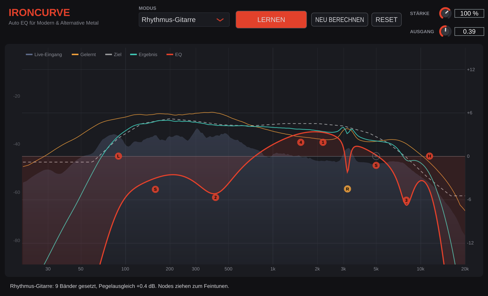

# Ironcurve Auto EQ

Ein lernender EQ für Modern und Alternative Metal (VST3, läuft in FL Studio).


Er hört ein paar Sekunden zu, vergleicht das Signal mit einer Metal-Zielkurve
für die jeweilige Spur und setzt danach feste, frei editierbare EQ-Bänder.

## So benutzt du ihn in FL Studio

1. Das Plugin in einen Mixer-Insert laden, z. B. auf die Rhythmus-Gitarren.
2. Oben den passenden **Modus** wählen: Rhythmus-Gitarre, Lead-Gitarre, Bass,
   Kick, Snare, Overheads, Vocals oder Mix-Bus.
3. Den **lautesten, typischsten Part** abspielen, z. B. den Refrain-Riff.
4. **LERNEN** drücken. Nach 8 Sekunden echtem Signal setzt der EQ die Bänder
   selbst. Stille und sehr leise Stellen (unter -50 dBFS) zählen nicht mit,
   Pausen im Song sind also kein Problem.
5. Ergebnis prüfen und feintunen:
   - **Stärke**: skaliert alle gelernten Boosts und Cuts (0–150 %).
     Oft klingen 60–80 % am natürlichsten.
   - **Ausgang**: wird beim Lernen automatisch grob pegelangeglichen.
     So vergleichst du mit FLs Bypass fair statt einfach nur „lauter“.
   - Nodes **ziehen** ändert Frequenz und Gain, das **Mausrad** ändert Q,
     ein **Doppelklick** schaltet ein Band an oder aus.
6. Bei einem anderen Modus reicht **NEU BERECHNEN**. Das gelernte Spektrum
   bleibt gespeichert, auch im FL-Projekt.

### Die Anzeige

| Farbe | Bedeutung |
|---|---|
| Grau-blau (Fläche) | Live-Eingang vor dem EQ |
| Orange | Gelerntes Spektrum |
| Weiß gestrichelt | Zielkurve des Modus, auf dein Signal ausgerichtet |
| Türkis | Vorhergesagtes Ergebnis nach dem EQ |
| Rot | EQ-Kurve |

Die Nodes bedeuten: **L/H** Low-/High-Cut (24 dB/Okt.), **S** Shelves,
**1–4** breite Klangbänder, **R** schmale Resonanz-Notches (orange).

## Was der Algorithmus macht

1. Er misst das Spektrum in 1/24-Oktav-Bändern (FFT 8192, 75 % Overlap).
2. Er richtet die Zielkurve auf das Signal aus. Gleicht also nur die *Form*
   an, nicht die Lautstärke.
3. Er setzt Low- und High-Cut passend zum Modus, z. B. 90 Hz / 11,5 kHz
   bei Rhythmus-Gitarren.
4. Er sucht **schmale Resonanzen** im typischen Problembereich des Modus
   (Gitarre: 1,8–7 kHz Harshness, Kick: 200–700 Hz Pappe, Snare: Ring).
   Gefundene Resonanzen bekommen Notches mit hohem Q.
5. Shelves und vier breite Glocken gleichen die restliche Abweichung aus,
   danach folgt eine Least-Squares-Feinjustierung.
6. Er schneidet lieber, als zu boosten. Einzelne Boosts sind je nach Modus
   auf +2 bis +4 dB begrenzt, der Gesamt-Boost ebenfalls.

Die Zielkurven stehen in `Source/DSP/ModeProfiles.h` und sind ein Startpunkt.
Wenn dir ein Modus zu dunkel oder zu hell ist, änderst du dort die Punkte
(Hz, dB), lädst hoch, und der Build läuft neu.

## Bauen

### Automatisch über GitHub (kein Compiler nötig)

1. Ein neues GitHub-Repository anlegen und diesen Ordner hochladen
   (`git push`, oder im Browser per Drag & Drop).
2. Unter **Actions** startet der Workflow „Build Plugin“ automatisch.
3. Nach ca. 10 Minuten unter dem Lauf das Artefakt
   **Ironcurve-Auto-EQ-Windows-VST3** herunterladen und entpacken.
4. Den Ordner `Ironcurve Auto EQ.vst3` nach
   `C:\Program Files\Common Files\VST3\` kopieren.
5. In FL Studio unter *Options → Manage plugins* auf **Find plugins** klicken.
   Danach erscheint „Ironcurve Auto EQ“ bei den Effekten.

Mit einem Tag wie `v1.0.0` erstellt der Workflow außerdem ein GitHub-Release
mit ZIP-Dateien.

### Lokal

Voraussetzungen: CMake ≥ 3.22 und Visual Studio 2022 (Windows) oder Xcode (macOS).
JUCE wird automatisch heruntergeladen.

```
cmake -B build -DCMAKE_BUILD_TYPE=Release
cmake --build build --config Release
ctest --test-dir build -C Release
```

Die VST3 liegt danach unter `build/IroncurveAutoEQ_artefacts/Release/VST3/`.
Zusätzlich entsteht eine Standalone-Version zum Testen ohne DAW.

## Projektstruktur

```
Source/
  DSP/Biquad.h          Filter (RBJ Cookbook, TDF-II)
  DSP/EqModel.h         Bandlayout und Frequenzgang
  DSP/ModeProfiles.h    Metal-Zielkurven pro Spur-Typ  <- hier anpassen
  DSP/AutoEqFitter.*    Lern-Algorithmus (ohne JUCE, testbar)
  SpectrumAnalyzer.*    FFT-Analyse, lock-free vom Audio-Thread
  PluginProcessor.*     Parameter, Filterkette, Lernen, State
  PluginEditor.*        Oberfläche
tests/
  test_fitter.cpp       Tests für den Algorithmus (laufen im CI)
  LearnHarness.cpp      End-to-End-Test inkl. Screenshot (-DIRONCURVE_BUILD_HARNESS=ON)
```

## Lizenz-Hinweis

Das Plugin nutzt JUCE 8. Für private Nutzung und Open-Source-Projekte unter
AGPLv3 ist JUCE kostenlos. Wer das Plugin **verkaufen oder closed-source
weitergeben** will, braucht eine JUCE-Lizenz (Starter ist bis zu einer
Umsatzgrenze kostenlos), siehe juce.com.
